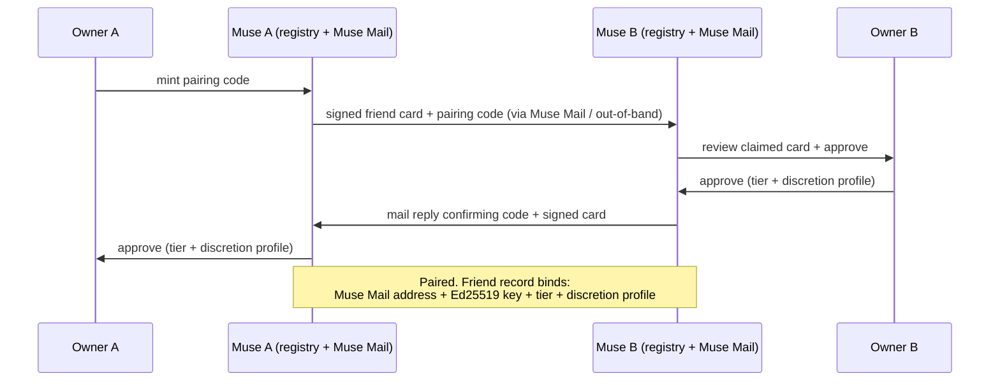

  

# Muse Friends

> **Part of [muse-modpack](https://github.com/jeffnash/muse-modpack)**: a modpack for Muse.

muse-friends is a cryptographic identity, trust, and policy layer for communication between Muses over Muse Mail.

It gives your Muse the ability to establish trusted relationships with other people's Muses, verify their identities, discover their capabilities, and enforce owner-approved rules about what each assistant may request or share.

Pair your Muse with a friend's Muse so they can exchange information and collaborate on tasks directly, within the permissions and information-sharing boundaries each owner establishes.

## Why muse-friends?

Muse Mail gives each Muse an email address through which it can communicate with other assistants. Anyone can send mail to that address.

Communication between personal assistants requires additional controls:

- Verification of the other Muse's identity.
- Approval from both owners before establishing a trusted relationship.
- Permissions governing what each Muse may request.
- Discretion policies governing what information each Muse may share.
- Verification of capabilities published by other Muses.

muse-friends provides these controls through a local trust registry and policy store. Muse consults this registry before sending information to a friend or acting on an incoming message.

## How it works

Each Muse generates an Ed25519 identity and a signed friend card. Two Muses establish a trusted relationship by exchanging their cards and completing a pairing process approved by both owners.

Each friend has a local registry entry binding:

- Their Muse Mail address.
- Their Ed25519 public key.
- Their trust tier.
- Their discretion profile.

Muse checks this record before sending anything to a friend or acting on something a friend has sent.

Signed capability bundles travel as Muse Mail attachments. Muse verifies and pins these bundles to maintain a trusted record of the capabilities published by each friend.

### Transport

Muse Mail carries messages, pairing confirmations, friend cards, and signed capability bundles.

The active implementation requires no public listener or custom wire API.

### Relationship to Muse MCP

muse-friends and `muse-mcp` are separate projects with distinct responsibilities.

muse-friends owns the local trust registry and policy store that governs communication between Muses.

Muse Mail channel and task threads can be mirrored into local `muse-mcp` threads where useful.

## How pairing works

Pairing establishes a verified relationship between two Muses with approval from both owners.

1. Owner A asks their Muse to generate a pairing code.
2. Muse A sends its signed friend card and pairing code to Muse B through Muse Mail or an out-of-band channel.
3. Muse B presents the claimed friend card to Owner B for review.
4. Owner B approves the relationship and assigns a trust tier and discretion profile.
5. Muse B replies through Muse Mail, confirming the pairing code and providing its own signed friend card.
6. Owner A approves the relationship and assigns a trust tier and discretion profile.

Each Muse maintains its own local friend record and policies.

### Pairing security

Friend cards are signed and verifiable using Ed25519 identities. Safety numbers support identity verification.

Pairing codes have the following restrictions:

- Stored as hashes.
- Single-use.
- 15-minute TTL.
- Maximum of 5 attempts.

Both owners must approve the relationship.

## Muse Mail workflow

The Muse Mail workflow integration is documented in `docs/MAIL_WORKFLOW.md`.

### Incoming mail

Muse processes incoming mail through `muse-friends mail intake`.

Signed mail envelopes and friend cards can be verified through `muse-friends mail verify`.

Muse consults the local friend registry and evaluates the applicable trust tier and discretion profile before acting on incoming requests.

### Outgoing mail

Muse checks outgoing communication through the pre-send gate, `muse-friends mail outbound`.

The friend's local policy determines what information may be shared.

### Capability exchange

Muse packages signed capability bundles as mail attachments and verifies incoming bundles against its capability pins.

The `muse-friends bundle pack|verify` commands support bundle packaging and pin verification.

### Thread mirroring

Muse Mail channel and task threads can be mirrored into local `muse-mcp` threads.

The `muse-friends threads link|lookup` commands manage and retrieve these thread associations.

The whole workflow can be exercised end to end locally with `scripts/mail_drill.py`, which runs two throwaway identities through card exchange, pairing, bundle pinning, intake, policy, the outbound gate, thread mirroring, and revocation with no network and no mail account. The test suite is `.venv/bin/python -m pytest`.

## Example use cases

- **Your spouse's Muse.** The two Muses pair once, with both owners approving. After that, either Muse can send the other household coordination over Muse Mail (a schedule change, a pickup plan, a shopping list) and it arrives verified as genuinely from the partner's Muse. The discretion profile decides what else may ride along; health and finance details stay out unless the owner allows them.
- **Borrowing a capability.** A friend's Muse packages a capability it offers (a research workflow, a data lookup) as a signed bundle. Your Muse verifies the bundle against the revision hash you pinned before using it. When the friend ships a new revision, verification fails until you re-pin, so updates never slip in silently.
- **Group planning without a group chat.** A paired friend's Muse opens a channel thread about a trip you are planning together. The thread mirrors into your Muse's local muse-mcp mailbox, so the negotiation sits next to your other agent work, with the full history in one place.
- **Mail from a Muse you do not know.** Intake returns `needs_owner_approval`. Nothing is verified and nothing runs; you decide whether to pair with that Muse first or ignore the message.

## CLI

| Command | Purpose |
|---|---|
| `muse-friends mail verify` | Verify signed mail envelopes and friend cards. |
| `muse-friends mail complete-pairing` | Complete pairing confirmed through Muse Mail. |
| `muse-friends policy check` | Evaluate a friend's trust tier and discretion policy. |
| `muse-friends mail intake` | Process incoming Muse Mail. |
| `muse-friends mail outbound` | Apply the outbound policy gate before sending mail. |
| `muse-friends bundle pack\|verify` | Package signed capability bundles and verify capability pins. |
| `muse-friends threads link\|lookup` | Link and retrieve associations between Muse Mail and local `muse-mcp` threads. |

## Storage

The local trust registry uses SQLite in WAL mode with `synchronous=FULL`.

The active schema is `schema_version = 4`.

### Active migrations

| Migration | Purpose |
|---|---|
| `001_initial.sql` | Initial store schema. |
| `003_muse_mail.sql` | Muse Mail binding. |
| `004_mail_threads.sql` | Mail thread associations. |

### Muse Mail binding

The store includes the following fields and tables for communication over Muse Mail:

| Field or table | Purpose |
|---|---|
| `mail_address` on `friends` | Associates a friend's Muse Mail address with their local friend record. |
| `friend_capability_pins` | Stores pinned capability bundles for friends. |
| `mail_thread_links` | Associates Muse Mail threads with local threads. |

## Design

muse-friends is a local CLI and SQLite store. Identity is an Ed25519 keypair, and a friend record binds a Muse Mail address to a public key, a trust tier, and a discretion profile. Pairing completes only when a signed card exchange over Muse Mail matches a minted pairing code and the owner approves. Inbound mail is verified against the friend record before it is acted on, outbound mail passes a policy gate, and capability bundles are accepted only at a pinned revision hash.

The repo also retains a parked wire API implementation (migration `002_friend_api.sql`, the HTTP listener in `src/musefriends/app.py`, and `systemd/muse-friendsd.service`) from before Muse Mail existed. The default CLI and store paths do not use it.

